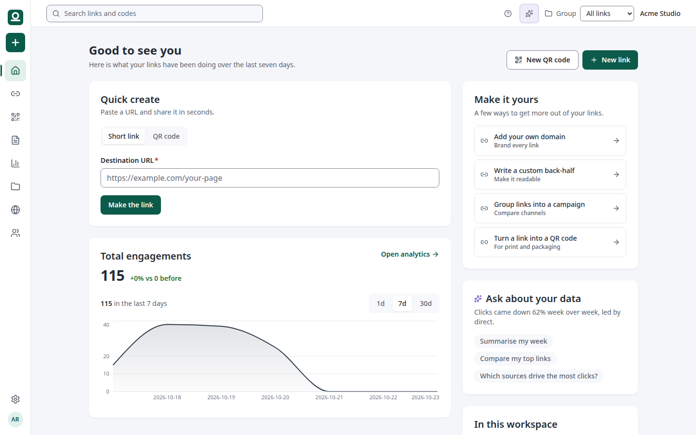

# Steadlink

[](LICENSE)
[](apps/web)
[](apps/web)
[](packages/db)
[](Dockerfile)

A self-hosted short link service: links, branded domains, QR codes, landing
pages, campaigns, webhooks, and a public REST API.

Everything runs on your own machine. There is no account to create, no
trial clock, and nothing that talks to a third party unless you point it
at something. The click goes straight to the destination: no page in
between, no ad, no countdown. The link you printed still works.

> **[Live demo →](https://steadlink.pages.dev)** · [Privacy policy](PRIVACY.md)



## Contents

- [What it does](#what-it-does)
- [What is not here yet](#what-is-not-here-yet)
- [The stack](#the-stack)
- [Running it with Docker](#running-it-with-docker)
- [Running it locally](#running-it-locally)
- [The tests](#the-tests)
- [The environment](#the-environment)
- [The access rules](#the-access-rules)
- [Contributing](#contributing)
- [Licence](#licence)

## What it does

- **Short links** on your own domain, with a back-half you choose, and
  filters for everything about them.
- **Groups**, so one workspace can keep several sets of links apart, and
  a picker in the shell says which one you are working in.
- **Branded domains**: add a domain, publish the two DNS records it asks
  for, and the domain is checked against the resolver.
- **QR codes** with a pattern, colours, a logo and a line of text,
  downloadable as SVG, PNG or JPEG.
- **Landing pages** built from blocks, published on their own slug.
- **Campaigns and channels**, so a push can be compared against the others.
- **Analytics**: clicks, scans and page views, by day, referrer, country,
  city and device, over a preset range or a range of your own.
- **Webhooks** for engagement, signed with a secret per webhook, delivered
  by a worker with a backoff.
- **A public API** at `/api/v4`, with personal access tokens and scopes.
- **A link checker** at `/check`, so anyone can see where a short link
  points without an account.
- **Mobile deep links** and **dynamic routing**, so one address can send
  people to different places.

## What is not here yet

The list is short and it is here so nobody has to find out the hard way:

- **No import.** Links export as a CSV; bringing a workspace in from another
  shortener is the next thing being built.
- **No mobile app.** The web app is responsive and installable; there is no
  iOS or Android binary.
- **No hosted service.** Self-hosting is the product, not a downgrade of one.
- **SSO is partial.** SAML is configured, not finished.
- **Webhook endpoint verification is partial.**
- **No bulk QR creation**, and no PDF or image export of a dashboard.

## The stack

| | |
| --- | --- |
| Language | TypeScript 7, on Node 24 |
| Web | Next.js 16, React 19, Tailwind 4, Biome |
| Database | PostgreSQL 17, Drizzle, row level security |
| Identity | better-auth: accounts, sessions, workspaces, API keys |
| Jobs | pg-boss, in the same database |
| Tests | Playwright, end to end, against a real database |

## Running it with Docker

```bash
cp .env.example .env
# set BETTER_AUTH_SECRET and the two database passwords
docker compose up -d
```

The application is on <http://localhost:3210>. The migrations run as the
superuser, the application as an unprivileged role, and the worker as
another one, so the row level security policies apply to the application
and not to the worker.

## Running it locally

```bash
pnpm install
cp .env.example .env      # fill in DATABASE_URL and BETTER_AUTH_SECRET
pnpm migrate              # apply the migrations
pnpm seed                 # two workspaces with realistic data
pnpm dev                  # the application, on http://localhost:3210
pnpm worker               # the scheduled jobs, in another terminal
```

The seed creates three people, and they all have the password
`steadlink-demo-password`:

| address | workspace |
| --- | --- |
| `arjav@example.com` | Acme Studio, owner |
| `mira@example.com` | Acme Studio, member |
| `sam@example.com` | Northwind Coffee, owner |

## The tests

```bash
pnpm test:access    # the access rules, against the real database
pnpm test:e2e       # the flows, in a browser
```

`pnpm test:e2e` needs a PostgreSQL to test against: one it can drop a
database in and create the roles in. It uses its own database,
`steadlink_test`, drops it, applies the migrations, seeds it, and starts the
application as the unprivileged role — the role it runs as in the
container. The spec files live in `e2e/`, one per flow.

The default is a PostgreSQL on `127.0.0.1:55440`. Point it somewhere
else with `E2E_DATABASE_URL` and `E2E_ADMIN_URL`.

```bash
pnpm test:e2e -- --headed        # watch it happen
pnpm test:e2e -- --project=mobile
pnpm test:e2e:report              # the report from the last run
```

Set `E2E_CHROMIUM` to use a Chromium of your own, and `E2E_DATABASE_URL`
to point at a different database.

## The environment

`.env.example` lists every variable with an explanation. The ones that
matter most:

| | |
| --- | --- |
| `DATABASE_URL` | the database the application uses |
| `DATABASE_MIGRATION_URL` | the database the migrations use, as a role that may create tables |
| `BETTER_AUTH_SECRET` | a long random string |
| `DEFAULT_SHORT_DOMAIN` | the base domain every workspace gets a subdomain of |
| `GEOIP_DATA_DIR` | where the country and city database lives |
| `BETTER_AUTH_SECURE_COOKIES` | set it if the proxy in front does not say what protocol the client used |

## The access rules

The application connects as a role that is a member of `steadlink_app`, and
the policies on the tables that hold one workspace's private material read
a transaction-local setting, `app.org_id`. A query that forgets to scope
itself returns nothing rather than everything.

The tables that are reached by a public identifier — a back-half, a page
slug, a domain host — are not under the policies, because the redirect
hot path resolves them without a session and without a workspace. Their
isolation is the `org_id` filter every query in the data layer carries,
and both halves are proved by tests.

`pnpm test:access` runs both: the policies against the database, and the
data layer against two workspaces with rows in them.

## Contributing

There is no `CONTRIBUTING.md` yet. In the meantime:

```bash
pnpm install
pnpm lint         # biome
pnpm typecheck
pnpm test:access  # the access rules, against a real database
pnpm test:e2e     # the flows, in a browser
```

The access rules are the part to be careful with. Any new query that reaches a
workspace's private material has to scope itself, or it returns nothing rather
than everything — that is deliberate, and `pnpm test:access` is what proves it.

Issues and pull requests are welcome.

---

## Licence

MIT. See `LICENSE`.
